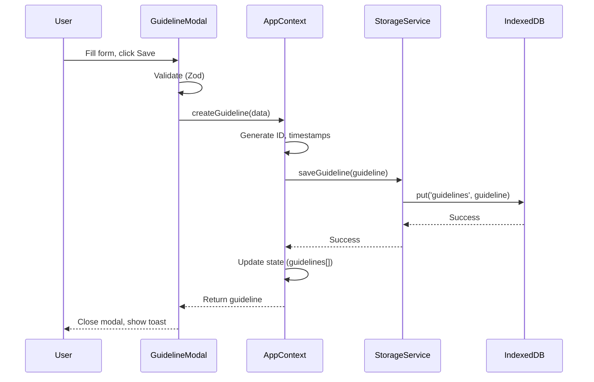
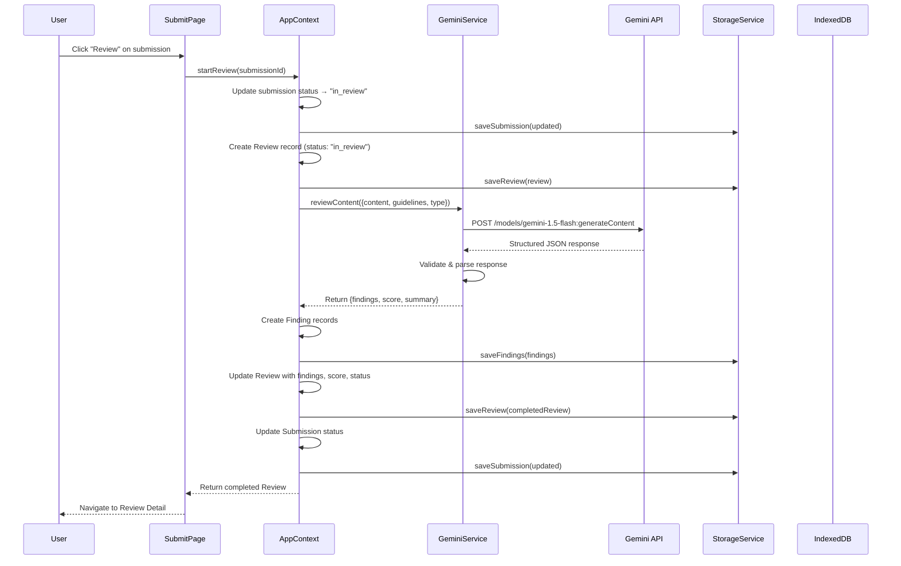
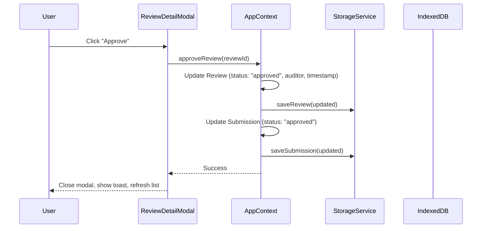
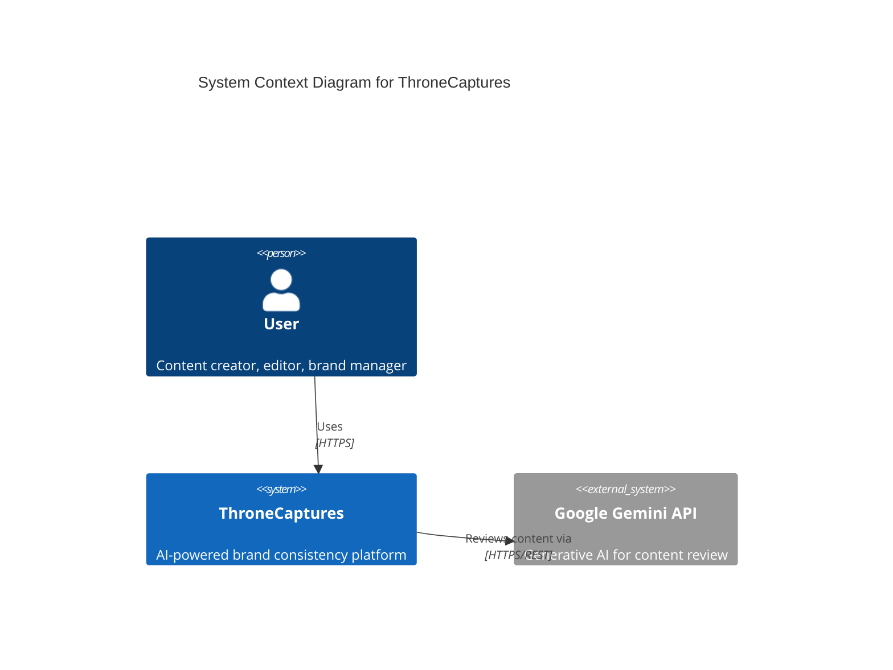
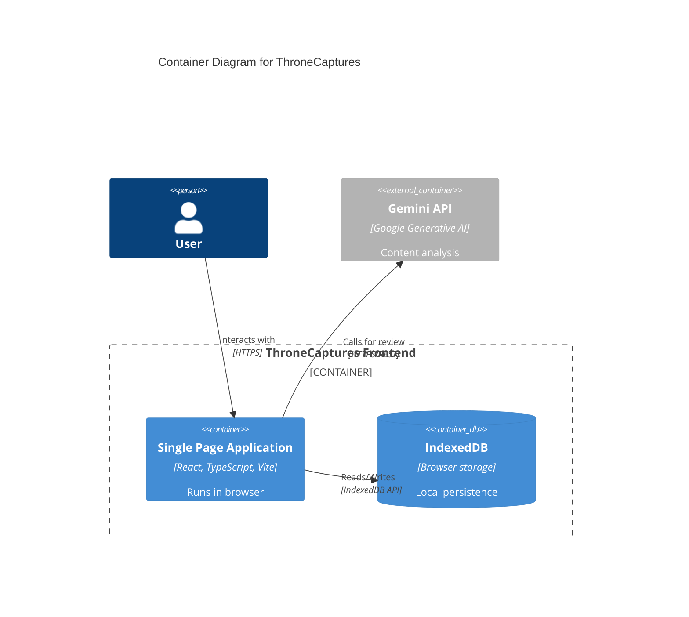
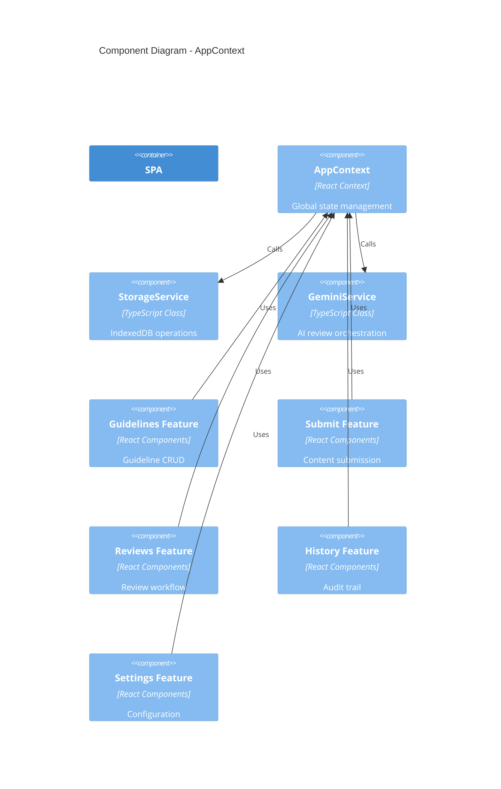
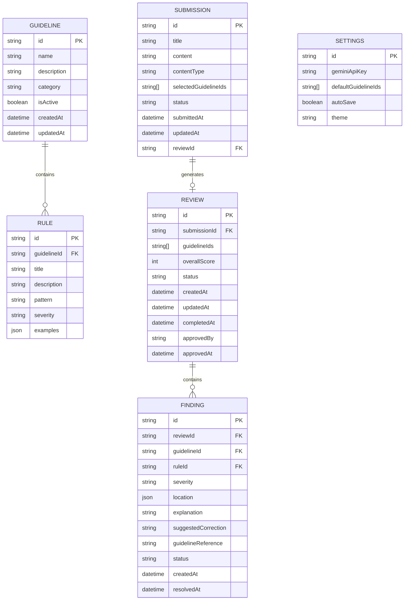

# Architecture Documentation

## ThroneCaptures — System Architecture & Data Flow

---

## 1. High-Level Architecture

```
┌─────────────────────────────────────────────────────────────────────────────┐
│                              THRONE CAPTURES ARCHITECTURE                     │
└─────────────────────────────────────────────────────────────────────────────┘

┌─────────────┐     ┌─────────────┐     ┌─────────────┐     ┌─────────────┐
│   PRESENT   │     │  APP STATE  │     │  SERVICES   │     │  STORAGE    │
│   LAYER     │────▶│  (CONTEXT)  │────▶│   LAYER     │────▶│  (INDEXEDDB)│
└─────────────┘     └─────────────┘     └─────────────┘     └─────────────┘
       │                   │                   │                   │
       ▼                   ▼                   ▼                   ▼
┌─────────────────────────────────────────────────────────────────────────────┐
│                        REACT COMPONENT TREE                                    │
│  App → MainLayout → [Sidebar, Header, Outlet] → Pages → Components           │
└─────────────────────────────────────────────────────────────────────────────┘
```

---

## 2. Component Architecture

### 2.1 Component Hierarchy

```
App (Providers: AppContext, ThemeContext)
├── MainLayout
│   ├── ThreeBackground (fixed, z-index: -10)
│   ├── Sidebar (desktop)
│   ├── MobileSidebar (overlay)
│   ├── Header
│   │   ├── Search (desktop only)
│   │   ├── Notifications Dropdown
│   │   ├── Theme Toggle
│   │   └── User Menu
│   └── Main Content Area
│       └── Outlet (Router)
│           ├── Dashboard
│           ├── Guidelines
│           │   ├── GuidelineCard[]
│           │   └── GuidelineModal (create/edit)
│           ├── Submit
│           │   ├── SubmissionCard[]
│           │   ├── SubmitModal
│           │   └── ViewSubmissionModal
│           ├── Reviews
│           │   ├── ReviewRow[]
│           │   └── ReviewDetailModal
│           │       ├── FindingsTab
│           │       ├── ContentTab
│           │       └── GuidelinesTab
│           ├── History
│           │   ├── HistoryRow[]
│           │   └── HistoryDetailModal
│           └── Settings
│               ├── API Key Section
│               ├── Appearance Section
│               └── Data Management Section
└── Toaster (portal to body)
```

### 2.2 Component Categories

| Category | Components | Responsibility |
|----------|------------|----------------|
| **Layout** | MainLayout, Sidebar, Header | Shell, navigation, responsive behavior |
| **Pages** | Dashboard, Guidelines, Submit, Reviews, History, Settings | Route-level features |
| **Features** | GuidelineCard, SubmissionCard, ReviewRow, HistoryRow | Domain-specific display |
| **Forms** | GuidelineModal, SubmitModal, Settings forms | Data input/editing |
| **Data Display** | ReviewDetailModal, HistoryDetailModal, ViewSubmissionModal | Detail views |
| **UI Primitives** | Button, Card, Input, Badge, Modal, Select, Textarea | Reusable building blocks |
| **Feedback** | Toast, Toaster, Loading states | User feedback |
| **Visual** | ThreeBackground | Ambient 3D element |

---

## 3. State Management

### 3.1 AppContext (Global State)

```typescript
interface AppState {
  guidelines: BrandGuideline[];
  submissions: ContentSubmission[];
  reviews: Review[];
  settings: UserSettings;
  currentView: ViewType;
  isLoading: boolean;
}
```

**Actions**: All CRUD operations for guidelines, submissions, reviews, findings, settings

**Persistence**: Automatic sync with IndexedDB via Storage Service

### 3.2 ThemeContext (UI State)

```typescript
interface ThemeContextType {
  theme: 'light' | 'dark' | 'system';
  resolvedTheme: 'light' | 'dark';
  setTheme: (theme) => void;
  toggleTheme: () => void;
}
```

**Persistence**: localStorage (`thronecaptures-theme`)

### 3.3 Local Component State

- Form inputs (controlled components)
- Modal open/close
- Active tabs
- Search/filter values
- Loading states

---

## 4. Data Flow Diagrams

### 4.1 Guideline Management Flow



### 4.2 AI Review Flow



### 4.3 Approval Flow



---

## 5. Services Layer

### 5.1 Storage Service (`src/services/storage/index.ts`)

**Responsibilities**: All IndexedDB operations

**API**:
```typescript
// Guidelines
getGuidelines(): Promise<BrandGuideline[]>
getGuideline(id): Promise<BrandGuideline | undefined>
saveGuideline(guideline): Promise<void>
deleteGuideline(id): Promise<void>

// Submissions
getSubmissions(): Promise<ContentSubmission[]>
getSubmission(id): Promise<ContentSubmission | undefined>
saveSubmission(submission): Promise<void>
deleteSubmission(id): Promise<void>

// Reviews
getReviews(): Promise<Review[]>
getReview(id): Promise<Review | undefined>
getReviewBySubmission(submissionId): Promise<Review | undefined>
saveReview(review): Promise<void>
deleteReview(id): Promise<void>

// Findings
getFindings(reviewId): Promise<ReviewFinding[]>
saveFinding(finding): Promise<void>
saveFindings(findings[]): Promise<void>
updateFindingStatus(id, status): Promise<void>

// Settings
getSettings(): Promise<UserSettings>
saveSettings(partial): Promise<UserSettings>

// Utility
clearAllData(): Promise<void>
generateId(): string
```

**Implementation**: `idb` wrapper with typed schema, indexes for query performance

### 5.2 Gemini Service (`src/services/ai/gemini.ts`)

**Responsibilities**: AI review orchestration

**API**:
```typescript
initialize(apiKey: string): void
isConfigured(): boolean
reviewContent(request: GeminiReviewRequest): Promise<GeminiReviewResponse>
```

**Configuration**:
- Model: `gemini-1.5-flash`
- Temperature: 0.1 (deterministic)
- Structured output via `responseSchema`
- Max tokens: 8192

**Prompt Building**: Dynamic prompt with all selected guidelines, rules, examples

**Validation**: Post-process response to ensure schema compliance, clamp scores

### 5.3 Utility Functions (`src/utils/date.ts`)

- `formatDistanceToNow()` — Relative time (e.g., "2h ago")
- `formatDate()` — Absolute date (e.g., "Nov 15, 2024")
- `formatDateTime()` — Date + time
- `truncate()` — Text truncation
- `getSeverityColor()` — CSS class for severity
- `getStatusColor()` — CSS class for status
- `classNames()` — Conditional class joining

---

## 6. Routing Structure

```
/
├── /                    → Dashboard
├── /guidelines          → Guidelines (list + create/edit modals)
├── /submit              → Submit Content (list + create/view modals)
├── /reviews             → Reviews (list)
│   └── /reviews/:id     → Review Detail (modal in same route)
├── /history             → History (unified timeline)
└── /settings            → Settings
```

**Navigation**: React Router v6 with `<Outlet>` in MainLayout

**Deep Linking**: Review detail accessible via `/reviews/:id` (modal opens on mount)

---

## 7. Mermaid Diagrams

### 7.1 System Context Diagram



### 7.2 Container Diagram



### 7.3 Component Diagram (AppContext)



### 7.4 Data Model (ERD)



---

## 8. Error Handling Strategy

| Layer | Strategy |
|-------|----------|
| **UI** | Error boundaries, toast notifications, inline form errors |
| **Context** | Try/catch in all async actions, state rollback on failure |
| **Services** | Typed errors, retry logic (Gemini), validation |
| **Storage** | Transaction atomicity, graceful degradation |
| **Network** | Timeout handling, offline detection, user-friendly messages |

---

## 9. Testing Strategy

| Level | Tools | Coverage Target |
|-------|-------|-----------------|
| **Unit** | Vitest | Services, utilities, pure functions |
| **Integration** | Vitest + React Testing Library | Context actions, service integration |
| **E2E** | Playwright (future) | Critical user flows |

**Key Test Scenarios**:
- Guideline CRUD persists to IndexedDB
- Content submission with guideline selection
- AI review returns structured findings
- Findings accept/reject updates state
- Approval workflow transitions correctly
- Theme persists across sessions
- API key saved and used for reviews